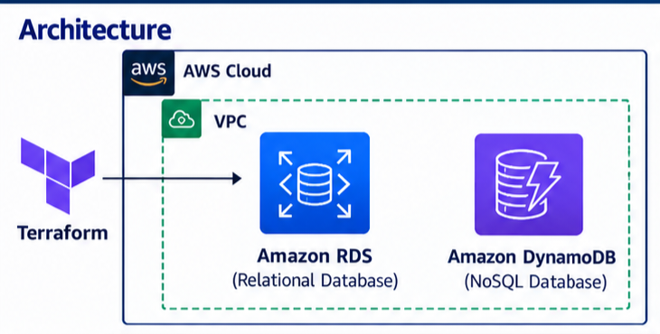

# terraform-aws-rds-dynamodb--github-project.
This project demonstratesInfrastructure as Code (laC) using Terraform to provision AWS database services.

# Terraform AWS RDS MySQL & DynamoDB

## Overview
This project uses Terraform to provision AWS database services
through Infrastructure as Code (IaC).

## AWS Services
- Amazon RDS for MySQL
- Amazon DynamoDB
- Amazon VPC
- AWS Security Groups
- Terraform AWS Provider

 ## Architecture



## Features
- Automated AWS infrastructure provisioning
- Encrypted RDS storage
- DynamoDB on-demand billing
- Configurable database settings
- Restricted MySQL network access
- DynamoDB point-in-time recovery

## Prerequisites
- AWS account
- AWS CLI configured with credentials
- Terraform installed
- Appropriate AWS IAM permissions

## Deployment

Initialize Terraform:

```bash
terraform init
